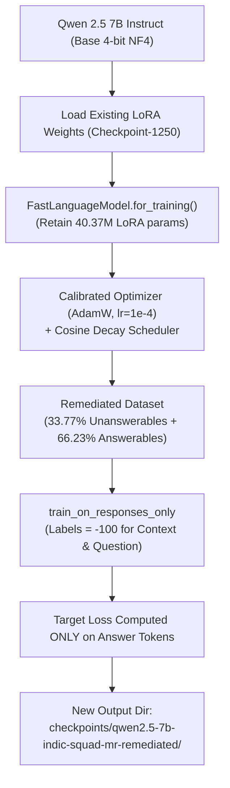

# UniGuru: Remediated Training Execution Guide & Plan

**Project:** BHIV UniGuru  
**Model:** Qwen 2.5 7B Instruct  
**Base Architecture:** QLoRA (4-bit NF4) / SFT with Unsloth  
**Primary Dataset:** Remediated Marathi Indic-SQuAD (`indic_squad_mr_train_remediated.jsonl`)  
**Hardware Environment:** NVIDIA GeForce RTX 3060 (12.0 GB VRAM, Compute 8.6, CUDA 12.1)  
**Date:** November 11, 2026  

---

## 1. Executive Summary

This document specifies the exact execution parameters, warm-start methodology, resource budget, and execution commands for fine-tuning Qwen 2.5 7B on the remediated Marathi Indic-SQuAD dataset.

### Core Objectives:
1. **Preserve Prior Extractive Capabilities**: Retain the high-quality Marathi language understanding and extractive QA representations already learned through checkpoints 1 to 1250.
2. **Inject Abstention & Boundary Awareness**: Train on 39,606 verified Stanford SQuAD 2.0 unanswerable records (33.77% of training set) so the model refrains from hallucinating when information is absent.
3. **Strict Parameter Allocation via Response Masking**: Ensure that loss gradients are computed 100% on target answer tokens (`"### Answer:\n"` to `<|im_end|>`), eliminating passage memorization noise.

---

## 2. Warm-Start Continuation Architecture

Rather than retraining from step 0 (which would discard hours of GPU compute), the pipeline supports warm-starting from the latest checkpoint (`checkpoints/qwen2.5-7b-indic-squad-mr-full/checkpoint-1250` or `checkpoint-1000`):



### Key Technical Properties:
- **Adapter Configuration**: $r=16, \alpha=16, \text{dropout}=0.0$, targeting all projection matrices (`q_proj`, `k_proj`, `v_proj`, `o_proj`, `gate_proj`, `up_proj`, `down_proj`).
- **Optimizer Re-calibration**: In the original run, learning rate followed a linear warmup down to $1.8 \times 10^{-4}$. For remediated continuation, we initiate at $\eta = 1.0 \times 10^{-4}$ with a 10-step warmup, allowing smooth adaptation to the newly introduced abstention target tokens without destroying pre-learned extractive weights.
- **Safety Isolation**: All output weights, optimizer states, and checkpoints are written to `checkpoints/qwen2.5-7b-indic-squad-mr-remediated/`. Legacy checkpoints in `checkpoints/qwen2.5-7b-indic-squad-mr-full/` are read-only.

---

## 3. Hardware & Runtime Budget on RTX 3060 (12GB VRAM)

| Parameter | Configuration | Technical Rationale |
| :--- | :--- | :--- |
| **Quantization** | 4-bit NF4 (`load_in_4bit=True`) | Fits 7B model in ~4.5GB VRAM |
| **Batch Size per Device** | 2 | Maximizes throughput within 12GB ceiling |
| **Gradient Accumulation** | 4 | Effective batch size = $2 \times 4 = 8$ samples |
| **Max Sequence Length** | 1280 tokens | Accommodates 99.8% of Marathi context+question pairs |
| **Precision** | `bf16=True, fp16=False` | Native Ampere BF16 prevents underflow & NaN loss |
| **Gradient Checkpointing** | `"unsloth"` | Minimizes activation memory overhead |
| **Optimizer** | `paged_adamw_8bit` | Offloads optimizer states dynamically |
| **Target Peak VRAM** | 9.4 GB - 10.8 GB | Safe margin below 12.0 GB physical capacity |
| **Step Throughput** | ~14 - 18 seconds / step | ~120 to 150 steps per hour |

---

## 4. Execution Commands

### Recommended Production Run (250 Warm-Start Steps)
This executes one full checkpoint cycle (250 steps, representing 2,000 training examples with 675 unanswerables), providing sufficient gradient signal to re-align the model's answer-decision boundary:

```powershell
# Run from repository root: C:\Ganesh_149\uniguru\bhiv-uniguru
$env:TRITON_CACHE_DIR = "C:\Ganesh_149\uniguru\bhiv-uniguru\.triton_cache"

.\venv\Scripts\python.exe training\llm_trainer.py `
  --dataset data\training\indic_squad_mr_train_remediated.jsonl `
  --val-dataset data\validation\indic_squad_mr_val_remediated.jsonl `
  --model-name checkpoints\qwen2.5-7b-indic-squad-mr-full\checkpoint-1250 `
  --output-dir checkpoints\qwen2.5-7b-indic-squad-mr-remediated `
  --adapter-dir models\adapters\qwen2.5-7b-indic-squad-mr-remediated `
  --epochs 1 `
  --batch-size 2 `
  --gradient-accumulation-steps 4 `
  --max-seq-length 1280 `
  --save-steps 250 `
  --max-steps 250 `
  --learning-rate 0.0001
```

### Alternative Fresh Run (From Base Qwen 2.5 7B)
If an entirely fresh run from the base model is preferred:

```powershell
$env:TRITON_CACHE_DIR = "C:\Ganesh_149\uniguru\bhiv-uniguru\.triton_cache"

.\venv\Scripts\python.exe training\llm_trainer.py `
  --dataset data\training\indic_squad_mr_train_remediated.jsonl `
  --val-dataset data\validation\indic_squad_mr_val_remediated.jsonl `
  --model-name "unsloth/Qwen2.5-7B-Instruct-bnb-4bit" `
  --output-dir checkpoints\qwen2.5-7b-indic-squad-mr-remediated-fresh `
  --adapter-dir models\adapters\qwen2.5-7b-indic-squad-mr-remediated-fresh `
  --epochs 1 `
  --batch-size 2 `
  --gradient-accumulation-steps 4 `
  --max-seq-length 1280 `
  --save-steps 250 `
  --max-steps 2500 `
  --learning-rate 0.0002
```

---

## 5. Verification Checklist After Training

Once a checkpoint is saved in `checkpoints/qwen2.5-7b-indic-squad-mr-remediated/`:
1. **Verify Loss Progression**:
   Inspect `checkpoints/qwen2.5-7b-indic-squad-mr-remediated/checkpoint-250/trainer_state.json` to confirm continuous loss decrease on response-only tokens.
2. **Execute Side-by-Side Model Comparison**:
   Run `inference/compare_models.py` with both answerable and unanswerable prompts:
   ```powershell
   .\venv\Scripts\python.exe inference\compare_models.py `
     --adapter-dir checkpoints\qwen2.5-7b-indic-squad-mr-remediated\checkpoint-250 `
     --context "ताजमहाल उत्तर प्रदेशातील आग्रा शहरात स्थित आहे. मुघल सम्राट शाहजहान यांनी त्यांची पत्नी मुमताज महल यांच्या स्मरणार्थ तो बांधण्याचे आदेश दिले. त्याचे बांधकाम १६३२ मध्ये सुरू झाले." `
     --question "या उताऱ्यानुसार ताजमहालाच्या बांधकामात किती कामगार सहभागी झाले होते?"
   ```
3. **Acceptance Criteria**:
   - The model must output `"दिलेल्या संदर्भामध्ये या प्रश्नाचे उत्तर उपलब्ध नाही."` for the missing workforce question.
   - The model must continue accurately extracting `"१६३२"` when asked for the start date.

